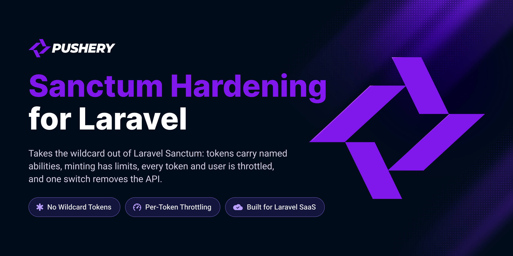

<p align="center">
  <a href="https://github.com/pushery/sanctum-hardening-for-laravel">
    
  </a>
</p>

# Sanctum Hardening for Laravel

[](https://packagist.org/packages/pushery/sanctum-hardening-for-laravel)
[](https://packagist.org/packages/pushery/sanctum-hardening-for-laravel)
[](https://packagist.org/packages/pushery/sanctum-hardening-for-laravel)
[](LICENSE)

[](https://pestphp.com)


[](https://phpstan.org)
[](https://laravel.com/docs/pint)

Hardens Laravel Sanctum: token abilities without a wildcard, limits on minting, per-token and per-user throttling, and a switch that removes the API.

## Documentation

**Full documentation at
[docs.pushery.com/sanctum-hardening-for-laravel](https://docs.pushery.com/sanctum-hardening-for-laravel/).**
This README is the quick start; the guides and the configuration reference live
there.

## Requirements

- PHP 8.4+
- Laravel 13+
- Laravel Sanctum 4, set up in the application

Before you start, set up Sanctum. `composer require` installs it along with this package but does
not set it up: `php artisan install:api` creates Sanctum's `personal_access_tokens` table and
`routes/api.php`, and the model that holds tokens, usually `App\Models\User`, uses Sanctum's
`Laravel\Sanctum\HasApiTokens` trait through the package's `HasApiKeys`, which makes `createToken()`
hand out a key in the package's format as well.

Tested on PostgreSQL and MySQL 8.4, the databases Laravel Cloud runs (serverless Postgres
and MySQL 8.4 LTS). The fast suite runs on SQLite.

Tested on the floor of the declared PHP range, because a `>=` promise is only proven
by running on the boundary, and on the minor version above it, so the range above the
floor is exercised here rather than first by a consumer.

## Installation

```bash
# 1. Set up Sanctum, unless the application already has
php artisan install:api
# 2. Install the package
composer require pushery/sanctum-hardening-for-laravel
# 3. Create the package's tables
php artisan migrate
```

The service provider is registered automatically through package discovery. The migrations create
seven tables of the package's own, and every row in them belongs to one token:

| Table | Holds | Deleted by |
|---|---|---|
| `sanctum_hardening_key_ids` | the identifier inside each token's key and the characters the key starts with, so a key finds its token and a person can tell their tokens apart | deleting the token through its model, `sanctum-hardening:prune-prefixes` once a query deleted the token, and `sanctum-hardening:prune-revocations` with a revoked token, whose identifier stays as long as the record of its revocation |
| `sanctum_hardening_token_prefixes` | nothing any more: it held the first characters of each secret of a token in Sanctum's own format, which no longer authenticates | an application that wants the table gone, with a migration of its own: `sanctum-hardening:prune-prefixes` no longer touches it |
| `sanctum_hardening_token_networks` | the addresses and networks a token is limited to | deleting the token through its model, `sanctum-hardening:prune-prefixes` once a query deleted the token, `sanctum-hardening:prune-revocations` with a revoked token, and `restrict()` of `TokenNetworks` with an empty list |
| `sanctum_hardening_token_alerts` | the alerts mailed for a token, by kind and occasion, so none is mailed twice | deleting the token through its model, `sanctum-hardening:prune-prefixes` once a query deleted the token, and `sanctum-hardening:prune-revocations` with a revoked token |
| `sanctum_hardening_token_rotations` | which token replaced which, who rotated it, and until when the replaced one works | deleting the token through its model, `sanctum-hardening:prune-prefixes` once a query deleted the token, and `sanctum-hardening:prune-revocations` with a revoked token |
| `sanctum_hardening_token_revocations` | who revoked which token and when: the token's name, its holder and the signed-in user who revoked it | `sanctum-hardening:prune-revocations`, once `revocations.keep_days` days have passed, 90 by default |
| `sanctum_hardening_token_uses` | the requests each token made: the route, the method, the status and the time, never what was sent | `sanctum-hardening:prune-uses`, once `usage.keep_days` days have passed, 30 by default |

The last two hold what a person did, who revoked a token and which requests a token made, for as
many days as their setting names. Sanctum's own `personal_access_tokens` table stays as
`php artisan install:api` created it.

## Configuration

Publish the configuration file:

```bash
php artisan vendor:publish --tag=sanctum-hardening-config
```

This writes `config/sanctum-hardening.php`, where every option is documented inline.

`php artisan migrate` runs the package's migrations from the package as they are. To keep them in
your application instead, decide before your first `php artisan migrate`: call
`\Pushery\SanctumHardening\SanctumHardeningServiceProvider::ignoreMigrations()` in the `register` method of your
`AppServiceProvider` first, then publish and run them:

```bash
php artisan vendor:publish --tag=sanctum-hardening-migrations
php artisan migrate
```

Without that call both copies stay registered, and with Laravel's default configuration the
published one runs under a new name and fails on a table that already exists. The same goes
for `--tag=sanctum-hardening`, which publishes every resource at once, the migrations included.

Publish the migrations once. The release notes name each migration a later release adds: copy
that file from `vendor/pushery/sanctum-hardening-for-laravel/database/migrations` into
`database/migrations`, renamed to start with today's date so it runs after the copies you have,
then run `php artisan migrate`. Publishing the tag again writes every migration a second time
under a new date, and `migrate` runs each copy as a new migration over the tables the original
created. If `php artisan migrate` has already run them from the package, as the installation
above does, copy the files from that directory under their own names instead of publishing
them: the `migrations` table knows them by those names, so `migrate` leaves them alone.

## Usage

**A token only narrows what its user may do, and never widens it.**

### Abilities without a wildcard

```php
// config/sanctum-hardening.php
'abilities' => ['orders:read' => 'Read orders', 'orders:write' => 'Write orders'],
'reserved' => ['device:sync'],
```

One catalog names every ability. Minting refuses the wildcard and an ability the catalog does not
know, and a reserved ability belongs to the application's own code. `php artisan
sanctum-hardening:doctor` names the tokens minted outside the package that carry either, each daily
command of the package that nothing schedules, the rows a prune should have deleted, and the mail
after a silence where Sanctum writes no last use, so none can go out. See
[Abilities](https://docs.pushery.com/sanctum-hardening-for-laravel/abilities). Schedule
`sanctum-hardening:prune-prefixes` beside `sanctum:prune-expired`, which deletes tokens without the
model events the package listens to, and `sanctum-hardening:prune-revocations`, which deletes the
record of who revoked a token and when once `revocations.keep_days` days have passed. A revoked token
is expired from that moment, so `sanctum:prune-expired --hours=24` deletes its row after a day; run it
with `--hours` at `revocations.keep_days` times 24 to keep the row as long as its record, and every
expired token stays that long.

### Minting with limits

```php
use Pushery\SanctumHardening\Tokens\PersonalTokens;

$request = request(); // the request of the signed-in user who mints the token
$minted = app(PersonalTokens::class)->mint($request, 'CI', ['orders:read'], 90);
```

A token is minted behind a password confirmed a moment ago, at most 20 per user and 5 a minute,
one at a time, with a lifetime from a list. `mintFor($request, $workspace, …)` mints a token that
belongs to a workspace under the same rules, where the application's Gate lets the user manage its
tokens. Every mint takes the addresses and networks a token may be used from as its last argument,
and a request from anywhere else is refused like an unknown token. See
[Minting](https://docs.pushery.com/sanctum-hardening-for-laravel/minting).

### Throttling and the switch

```php
// bootstrap/app.php
use Pushery\SanctumHardening\SanctumHardening;

->withRouting(
    // web, api, commands and health as Laravel wrote them
    then: function () {
        SanctumHardening::routes(function () {
            // the API's routes, under /api
        });
    },
)
```

Registered there, outside the group Laravel puts around `routes/api.php`, the routes answer under
`/api`. A call inside `routes/api.php` needs the `routes` settings the documentation names, or the
prefix `api` applies twice.

The API runs behind a limit per token and one per user over all of their tokens, and answers
`429` as a problem document. `SANCTUM_HARDENING_ENABLED=false` removes its routes altogether. A
route the route cache still holds answers `404` from the next request on, and with a cached
configuration the switch takes effect once `php artisan optimize` caches the configuration and
then the routes again. The last use of a token is written once a minute instead of on every
request. Every request is recorded with its route, method and status, never the values it
carried, and `sanctum-hardening:prune-uses` deletes the records after `usage.keep_days` days. See
[Throttling and the switch](https://docs.pushery.com/sanctum-hardening-for-laravel/throttling).

### The screen

```blade
<livewire:sanctum-hardening.tokens />
```

With Livewire installed, a page behind `auth` embeds the self-service screen: a person mints a token
with the abilities of the catalog, sees its plain text once, and revokes their tokens, or those of a
workspace the Gate lets them manage (`:tokenable="$workspace"`). Where the password was not confirmed
a moment ago, the screen asks for it itself. On a page with a header of its own, `:heading="false"`
leaves out the screen's heading and the sentence under it. See
[The screen](https://docs.pushery.com/sanctum-hardening-for-laravel/screen).

### Alerts

```php
use Illuminate\Support\Facades\Schedule;

Schedule::command('sanctum-hardening:send-alerts')->daily();
```

The holder of a token gets a mail 7 days before it expires and once no request has used it for 90
days, each sent once, with a link to the page `sanctum-hardening.alerts.link` names, where the token
is revoked. The command and the package's prunes run once at a time through a lock in the default
cache store, so servers that run the scheduler together need a store they share. See
[Alerts](https://docs.pushery.com/sanctum-hardening-for-laravel/alerts).

## Testing

The test suite is not part of the published package: the tests and their PHPUnit
configuration stay in the development repository, so a clone of this repository has no
`composer test`. [CONTRIBUTING.md](https://github.com/pushery/sanctum-hardening-for-laravel/blob/main/CONTRIBUTING.md) says how a change is tested on its way in.

## Security

Please review the [security policy](SECURITY.md) and report vulnerabilities
privately rather than opening a public issue.

## Built by PUSHERY

This package is built and maintained by [PUSHERY](https://www.pushery.com) — a
Berlin-based studio building Laravel applications, SaaS products, and open-source
tools.

Building a Laravel UI? [WireKit](https://www.wirekit.app) is PUSHERY's open-source
Livewire component kit.
Browse the rest of our work at [pushery.com](https://www.pushery.com).

## License

The MIT License (MIT). See [LICENSE](LICENSE) for details.
