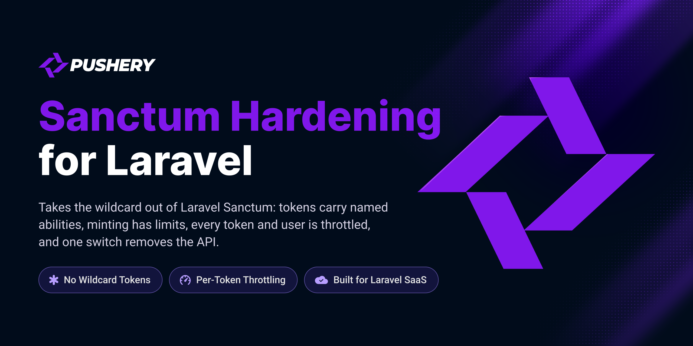

<p align="center">
  <a href="https://github.com/pushery/sanctum-hardening-for-laravel">
    
  </a>
</p>

# Sanctum Hardening for Laravel

[](https://packagist.org/packages/pushery/sanctum-hardening-for-laravel)
[](https://packagist.org/packages/pushery/sanctum-hardening-for-laravel)
[](https://packagist.org/packages/pushery/sanctum-hardening-for-laravel)
[](LICENSE)

[](https://pestphp.com)


[](https://phpstan.org)
[](https://laravel.com/docs/pint)

Hardens Laravel Sanctum: token abilities without a wildcard, limits on minting, per-token and per-user throttling, and a switch that removes the API.

## Documentation

**Full documentation at
[docs.pushery.com/sanctum-hardening-for-laravel](https://docs.pushery.com/sanctum-hardening-for-laravel/).**
This README is the quick start; the guides and the configuration reference live
there.

## Requirements

- PHP 8.4+
- Laravel 13+

Tested on PostgreSQL and MySQL 8.4, the databases Laravel Cloud runs (serverless Postgres
and MySQL 8.4 LTS), so it runs there out of the box. The fast suite runs on SQLite.

Tested on **PHP 8.4** — the floor of the declared range, because a `>=` promise is
only proven by running on the boundary — and on **PHP 8.5**, so the upper half of
`^8.4` is exercised here rather than first by a consumer.

## Installation

```bash
composer require pushery/sanctum-hardening-for-laravel
```

The service provider is registered automatically through package discovery.

## Configuration

Publish the configuration file:

```bash
php artisan vendor:publish --tag=sanctum-hardening-config
```

This writes `config/sanctum-hardening.php`, where every option is documented inline.

The package keeps the prefix of each token in a table of its own,
`sanctum_hardening_token_prefixes`, and `php artisan migrate` runs its migration from the package
as it is. To keep the migration in your application instead, call
`\Pushery\SanctumHardening\SanctumHardeningServiceProvider::ignoreMigrations()` in the `register` method of your
`AppServiceProvider` first, then publish and run it:

```bash
php artisan vendor:publish --tag=sanctum-hardening-migrations
php artisan migrate
```

Without that call both copies stay registered, and with Laravel's default configuration the
published one runs under a new name and fails on a table that already exists. The same goes
for `--tag=sanctum-hardening`, which publishes every resource at once, the migrations included.

## Usage

**A token only narrows what its user may do, and never widens it.**

### Abilities without a wildcard

```php
// config/sanctum-hardening.php
'abilities' => ['orders:read' => 'Read orders', 'orders:write' => 'Write orders'],
'reserved' => ['device:sync'],
```

One catalog names every ability. Minting refuses the wildcard and an ability the catalog does not
know, and a reserved ability belongs to the application's own code. `php artisan
sanctum-hardening:doctor` names the tokens minted outside the package that carry either. See
[Abilities](https://docs.pushery.com/sanctum-hardening-for-laravel/abilities). Schedule
`sanctum-hardening:prune-prefixes` beside `sanctum:prune-expired`, which deletes tokens without the
model events the package listens to, and `sanctum-hardening:prune-revocations`: a revoked token keeps
its row, expired, with a record of who revoked it and when, until `revocations.keep_days` days have
passed.

### Minting with limits

```php
use Pushery\SanctumHardening\Tokens\PersonalTokens;

$minted = app(PersonalTokens::class)->mint($request, 'CI', ['orders:read'], 90);
```

A token is minted behind a password confirmed a moment ago, at most 20 per user and 5 a minute,
one at a time, with a lifetime from a list. `mintFor($request, $workspace, …)` mints a token that
belongs to a workspace under the same rules, where the application's Gate lets the user manage its
tokens. Every mint takes the addresses and networks a token may be used from as its last argument,
and a request from anywhere else is refused like an unknown token. See
[Minting](https://docs.pushery.com/sanctum-hardening-for-laravel/minting).

### Throttling and the switch

```php
use Pushery\SanctumHardening\SanctumHardening;

SanctumHardening::routes(function () {
    // the API's routes
});
```

The API runs behind a limit per token and one per user over all of their tokens, and answers
`429` as a problem document. `SANCTUM_HARDENING_ENABLED=false` removes its routes altogether, and
the last use of a token is written once a minute instead of on every request. Every request is
recorded with its route, method and status, never the values it carried, and
`sanctum-hardening:prune-uses` deletes the records after `usage.keep_days` days. See
[Throttling and the switch](https://docs.pushery.com/sanctum-hardening-for-laravel/throttling).

### The screen

```blade
<livewire:sanctum-hardening.tokens />
```

With Livewire installed, a page behind `auth` and `password.confirm` embeds the self-service screen:
a person mints a token with the abilities of the catalog, sees its plain text once, and revokes their
tokens. See [The screen](https://docs.pushery.com/sanctum-hardening-for-laravel/screen).

## Testing

The test suite is not part of the published package: the tests and their PHPUnit
configuration stay in the development repository, so a clone of this repository has no
`composer test`. [CONTRIBUTING.md](CONTRIBUTING.md) says how a change is tested on its way in.

## Security

Please review the [security policy](SECURITY.md) and report vulnerabilities
privately rather than opening a public issue.

## Built by Pushery

This package is built and maintained by [Pushery](https://www.pushery.com) — a
Berlin-based studio building Laravel applications, SaaS products, and open-source
tools.

Building a Laravel UI? [WireKit](https://www.wirekit.app) is Pushery's open-source
Livewire component kit.
Browse the rest of our work at [pushery.com](https://www.pushery.com).

## License

The MIT License (MIT). See [LICENSE](LICENSE) for details.
